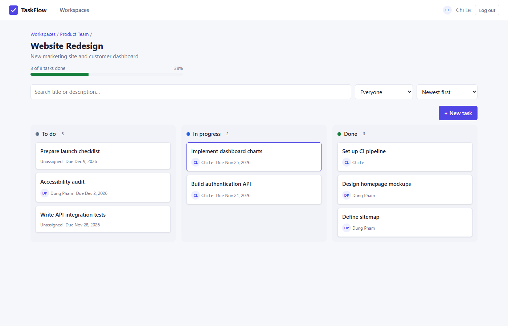
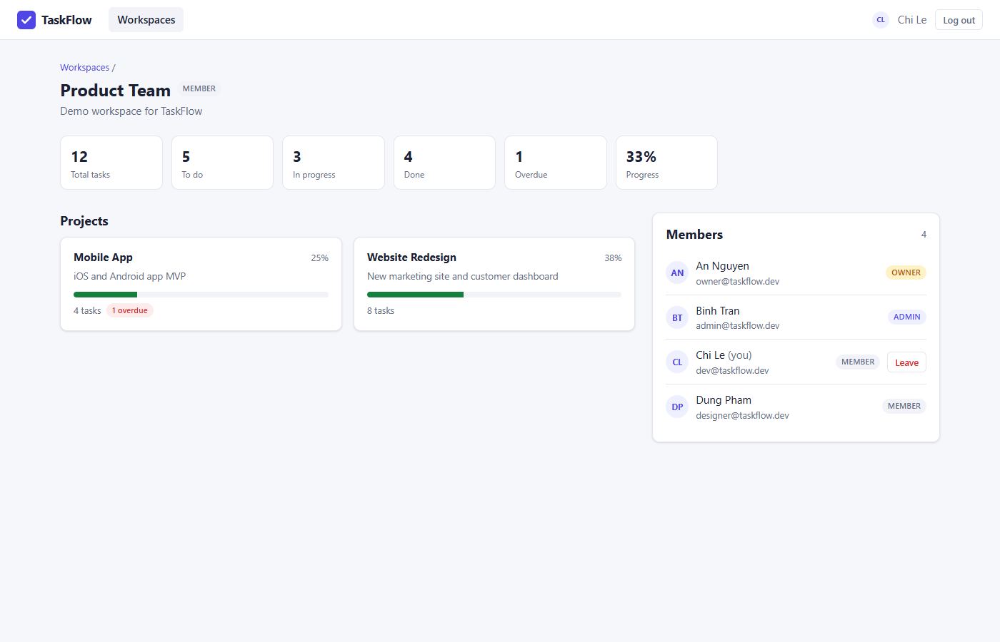
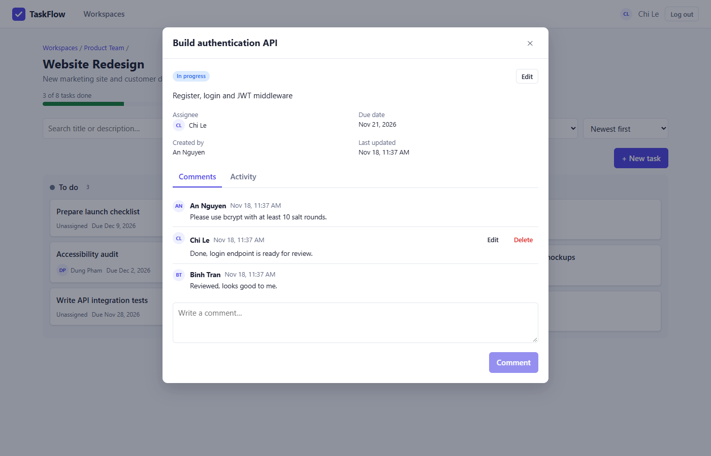
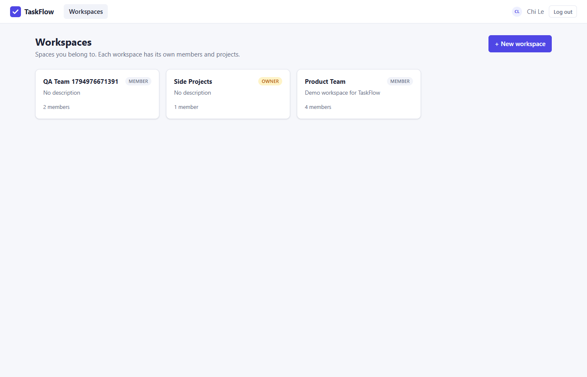
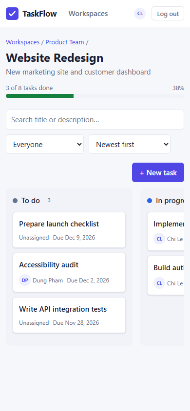

# TaskFlow — Team Task Management System

[](https://github.com/NHP204/TaskFlow/actions/workflows/ci.yml)

Ứng dụng quản lý công việc nhóm: tạo workspace, mời thành viên với vai trò `OWNER` / `ADMIN` /
`MEMBER`, tổ chức project, giao task, theo dõi tiến độ trên Kanban board, bình luận và xem lịch sử
thay đổi của từng task.



## Tính năng

- **Xác thực:** đăng ký, đăng nhập, đăng xuất; JWT lưu trong cookie `httpOnly`, mật khẩu hash bằng bcrypt.
- **Workspace và thành viên:** thêm thành viên theo email, đổi vai trò, xóa thành viên hoặc tự rời
  workspace; phân quyền theo vai trò ở cấp từng tài nguyên.
- **Project và task:** CRUD, giao task cho thành viên, deadline, trạng thái `TODO` → `IN_PROGRESS` → `DONE`.
- **Danh sách task:** lọc theo trạng thái, người phụ trách, khoảng deadline; tìm kiếm theo từ khóa;
  sắp xếp; phân trang.
- **Lịch sử và bình luận:** mọi thay đổi của task được ghi vào activity log với giá trị cũ/mới; bình luận
  trong task.
- **Thống kê:** số task theo trạng thái, % hoàn thành, task quá hạn, tiến độ từng project.
- **Giao diện React:** Kanban kéo thả, form có validation, trạng thái loading / empty / error, responsive.
- **Chất lượng:** unit test và integration test, OpenAPI/Swagger, Docker Compose, GitHub Actions CI.

## Công nghệ

| Thành phần | Công nghệ                                                            |
| ---------- | -------------------------------------------------------------------- |
| Backend    | Node.js 22, Express 5, ES Modules                                    |
| Database   | PostgreSQL 16, `pg` (SQL thuần), `node-pg-migrate`                   |
| Bảo mật    | JWT (HS256) trong cookie `httpOnly`, bcrypt, helmet, kiểm tra Origin |
| Validation | Joi                                                                  |
| Frontend   | React 19, Vite, React Router, Axios, CSS thuần                       |
| Testing    | Jest + Supertest (backend), Vitest + Testing Library (frontend)      |
| Tài liệu   | OpenAPI 3 + Swagger UI                                               |
| DevOps     | Docker, Docker Compose, nginx, GitHub Actions                        |

## Kiến trúc

```text
Browser ──► nginx (frontend build) ──/api──► Express API ──► PostgreSQL
                                              │
     Routes ─► Middleware ─► Controller ─► Service ─► Repository ─► SQL
               authenticate   HTTP in/out   business   parameterized
               validate (Joi)               rules,     queries
               checkOrigin                  access,
                                            transactions
```

- **Controller** chỉ xử lý HTTP; **Service** chứa quy tắc nghiệp vụ và kiểm tra quyền;
  **Repository** là nơi duy nhất viết SQL.
- Mọi dependency được nối trong [`backend/src/container.js`](backend/src/container.js) và truyền vào
  qua tham số (dependency injection), nên unit test chỉ cần truyền mock.
- Chi tiết thiết kế và lý do lựa chọn: [docs/architecture.md](docs/architecture.md).

```text
taskflow/
├── backend/
│   ├── migrations/          # SQL migration
│   ├── scripts/             # migrate, seed, sinh tài liệu API
│   ├── src/
│   │   ├── config/          # env, database pool
│   │   ├── controllers/
│   │   ├── docs/            # OpenAPI spec
│   │   ├── middlewares/     # authenticate, validate, checkOrigin, errorHandler
│   │   ├── repositories/
│   │   ├── routes/
│   │   ├── services/
│   │   ├── validators/
│   │   ├── utils/
│   │   ├── container.js     # dependency injection
│   │   ├── app.js
│   │   └── server.js
│   └── tests/               # unit/ và integration/
├── frontend/
│   └── src/                 # components/, pages/, hooks/, services/, contexts/, utils/
├── docs/                    # đặc tả, ERD, kiến trúc, API specification, ảnh chụp màn hình
├── docker-compose.yml
└── .github/workflows/ci.yml
```

## Chạy nhanh bằng Docker

Yêu cầu: Docker.

```bash
cp .env.example .env                 # đặt JWT_SECRET là một chuỗi ngẫu nhiên dài
docker compose --profile app up -d --build

# (Tùy chọn) nạp dữ liệu demo — xóa dữ liệu hiện có
docker compose exec -e ALLOW_SEED=true backend node scripts/seed.js
```

| URL                            | Nội dung       |
| ------------------------------ | -------------- |
| http://localhost:8080          | Ứng dụng React |
| http://localhost:8080/api-docs | Swagger UI     |
| http://localhost:8080/api/v1   | REST API       |

nginx phục vụ frontend và chuyển `/api`, `/api-docs` sang backend, nên mọi thứ chạy trên cùng một
origin. Backend tự chạy migration khi khởi động.

### Tài khoản demo

Mật khẩu chung: `password123`

| Email                   | Vai trò trong "Product Team"            |
| ----------------------- | --------------------------------------- |
| `owner@taskflow.dev`    | OWNER                                   |
| `admin@taskflow.dev`    | ADMIN                                   |
| `dev@taskflow.dev`      | MEMBER                                  |
| `designer@taskflow.dev` | MEMBER                                  |
| `guest@taskflow.dev`    | Không thuộc workspace nào (thử lỗi 403) |

## Phát triển

Yêu cầu: Node.js >= 20.11 và Docker (cho PostgreSQL).

```bash
# PostgreSQL với 2 database: taskflow_dev và taskflow_test
docker compose up -d

# Backend — http://localhost:3000
cd backend
npm install
cp .env.example .env
cp .env.test.example .env.test
npm run migrate
npm run seed            # tùy chọn
npm run dev

# Frontend — http://localhost:5173 (terminal khác)
cd frontend
npm install
npm run dev
```

Vite proxy `/api` sang `localhost:3000`, nên khi phát triển frontend và API cũng cùng origin.

### Lệnh

| Thư mục  | Lệnh                    | Mô tả                                                 |
| -------- | ----------------------- | ----------------------------------------------------- |
| backend  | `npm run dev`           | Chạy API với nodemon                                  |
| backend  | `npm test`              | Unit + integration test trên database `taskflow_test` |
| backend  | `npm run test:coverage` | Test kèm báo cáo coverage                             |
| backend  | `npm run migrate`       | Áp dụng migration (`migrate:down` để rollback)        |
| backend  | `npm run seed`          | Reset database dev và nạp dữ liệu demo                |
| backend  | `npm run docs`          | Validate OpenAPI và sinh `docs/api-specification.md`  |
| backend  | `npm run lint`          | ESLint (`format` / `format:check` cho Prettier)       |
| frontend | `npm run dev`           | Dev server                                            |
| frontend | `npm test`              | Vitest + Testing Library                              |
| frontend | `npm run build`         | Build production vào `dist/`                          |
| frontend | `npm run lint`          | ESLint                                                |

### Biến môi trường (backend)

| Biến                 | Bắt buộc | Mặc định              | Mô tả                                              |
| -------------------- | -------- | --------------------- | -------------------------------------------------- |
| `DATABASE_URL`       | ✓        |                       | Chuỗi kết nối PostgreSQL                           |
| `JWT_SECRET`         | ✓        |                       | Khóa ký JWT; thiếu thì server không khởi động      |
| `JWT_EXPIRES_IN`     |          | `1h`                  | Thời hạn token và cookie                           |
| `PORT`               |          | `3000`                | Cổng HTTP                                          |
| `CORS_ORIGIN`        |          |                       | Danh sách origin frontend, phân tách bằng dấu phẩy |
| `COOKIE_SECURE`      |          | `true` khi production | Cờ `Secure` của cookie; bật khi chạy sau HTTPS     |
| `BCRYPT_SALT_ROUNDS` |          | `10`                  | Số vòng bcrypt                                     |
| `NODE_ENV`           |          | `development`         | `test` dùng `.env.test`                            |

File `.env` ở thư mục gốc dành cho Docker Compose (xem [`.env.example`](.env.example)). Không commit file `.env`.

## API

Base URL `/api/v1`. Tài liệu đầy đủ: Swagger UI tại `/api-docs` hoặc
[docs/api-specification.md](docs/api-specification.md) (sinh tự động từ OpenAPI spec).

Response thống nhất:

```json
{
  "success": true,
  "data": { "id": 101, "title": "Build authentication API" },
  "message": "Task retrieved successfully"
}
```

```json
{
  "success": false,
  "data": null,
  "message": "Validation failed",
  "errors": [{ "field": "title", "message": "title is required" }]
}
```

| Method | Endpoint                          | Mô tả                                          |
| ------ | --------------------------------- | ---------------------------------------------- |
| POST   | `/auth/register`                  | Đăng ký, đặt cookie                            |
| POST   | `/auth/login`                     | Đăng nhập, đặt cookie                          |
| POST   | `/auth/logout`                    | Xóa cookie                                     |
| GET    | `/auth/me`                        | User hiện tại                                  |
| GET    | `/workspaces`                     | Workspace của user                             |
| POST   | `/workspaces`                     | Tạo workspace (người tạo là OWNER)             |
| GET    | `/workspaces/:id`                 | Chi tiết và thành viên                         |
| PATCH  | `/workspaces/:id`                 | Cập nhật (OWNER, ADMIN)                        |
| DELETE | `/workspaces/:id`                 | Xóa (OWNER)                                    |
| POST   | `/workspaces/:id/members`         | Thêm thành viên theo email                     |
| PATCH  | `/workspaces/:id/members/:userId` | Đổi vai trò (OWNER)                            |
| DELETE | `/workspaces/:id/members/:userId` | Xóa thành viên / rời workspace                 |
| GET    | `/workspaces/:id/projects`        | Project của workspace                          |
| GET    | `/workspaces/:id/stats`           | Thống kê workspace                             |
| POST   | `/projects`                       | Tạo project (OWNER, ADMIN)                     |
| GET    | `/projects/:id`                   | Chi tiết project                               |
| PATCH  | `/projects/:id`                   | Cập nhật (OWNER, ADMIN)                        |
| DELETE | `/projects/:id`                   | Xóa (OWNER, ADMIN)                             |
| GET    | `/projects/:id/tasks`             | Task: lọc, tìm kiếm, sắp xếp, phân trang       |
| GET    | `/projects/:id/stats`             | Thống kê project                               |
| POST   | `/tasks`                          | Tạo task                                       |
| GET    | `/tasks/:id`                      | Chi tiết task                                  |
| PATCH  | `/tasks/:id`                      | Cập nhật (quản lý, người tạo, người được giao) |
| DELETE | `/tasks/:id`                      | Xóa (quản lý, người tạo)                       |
| GET    | `/tasks/:id/activity`             | Lịch sử thay đổi                               |
| GET    | `/tasks/:id/comments`             | Bình luận                                      |
| POST   | `/tasks/:id/comments`             | Thêm bình luận                                 |
| PATCH  | `/comments/:id`                   | Sửa bình luận (tác giả)                        |
| DELETE | `/comments/:id`                   | Xóa bình luận (tác giả, OWNER, ADMIN)          |

Ví dụ lọc task:

```http
GET /api/v1/projects/12/tasks?status=IN_PROGRESS&assigneeId=5&search=login&sortBy=dueDate&order=asc&page=1&limit=10
```

### Phân quyền

| Hành động                    | OWNER | ADMIN      | MEMBER                          |
| ---------------------------- | ----- | ---------- | ------------------------------- |
| Xem workspace, project, task | ✓     | ✓          | ✓                               |
| Sửa workspace                | ✓     | ✓          |                                 |
| Xóa workspace                | ✓     |            |                                 |
| Thêm thành viên              | ✓     | chỉ MEMBER |                                 |
| Đổi vai trò                  | ✓     |            |                                 |
| Xóa thành viên               | ✓     | chỉ MEMBER | chỉ bản thân (rời)              |
| Tạo / sửa / xóa project      | ✓     | ✓          |                                 |
| Tạo task, bình luận          | ✓     | ✓          | ✓                               |
| Sửa task                     | ✓     | ✓          | nếu là người tạo hoặc được giao |
| Xóa task                     | ✓     | ✓          | nếu là người tạo                |

User không thuộc workspace nhận `403`; tài nguyên không tồn tại nhận `404`. OWNER không thể bị xóa
hoặc đổi vai trò. Khi một thành viên bị xóa, các task đang giao cho họ trong workspace được bỏ giao.

## Kiểm thử và CI

- **Backend:** unit test cho service (repository được mock qua dependency injection) và integration
  test gọi API thật trên database `taskflow_test` riêng, gồm các trường hợp 400, 401, 403, 404, 409.
- **Frontend:** test cho form đăng nhập, logic Kanban (cập nhật lạc quan và rollback), quyền hiển thị,
  định dạng.
- **GitHub Actions** chạy trên mọi push và pull request: lint, Prettier, kiểm tra tài liệu API khớp
  spec, test backend với PostgreSQL service kèm coverage, test và build frontend, build Docker image.

## Ảnh chụp màn hình

| Workspace                                      | Chi tiết task                                    |
| ---------------------------------------------- | ------------------------------------------------ |
|    |  |
| **Danh sách workspace**                        | **Mobile**                                       |
|  |      |

## Triển khai

Repo chưa deploy lên host công khai. Các bước khi triển khai:

1. Tạo PostgreSQL managed (Neon, Supabase, RDS...) và lấy `DATABASE_URL`.
2. Build và chạy image `backend/` với `NODE_ENV=production`, `DATABASE_URL`, `JWT_SECRET` ngẫu nhiên
   và `COOKIE_SECURE=true`. Container tự chạy migration khi khởi động.
3. Build image `frontend/` (nginx). Nếu backend nằm ở host khác, sửa `proxy_pass` trong
   [`frontend/nginx.conf`](frontend/nginx.conf) trỏ tới backend để giữ cùng origin.
4. Đặt toàn bộ sau HTTPS. Nếu frontend và API khác origin, thêm origin frontend vào `CORS_ORIGIN`
   (cookie `SameSite=Lax` yêu cầu hai bên cùng site).

## Tài liệu

- [Đặc tả dự án](docs/project-specification.md)
- [Kiến trúc và quyết định thiết kế](docs/architecture.md)
- [Thiết kế database (ERD)](docs/erd.md)
- [API specification](docs/api-specification.md)
