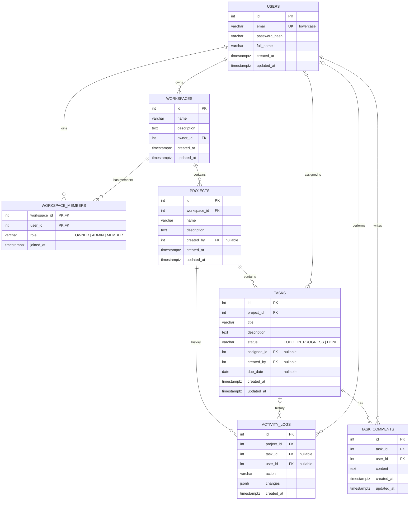

# TaskFlow — Thiết kế cơ sở dữ liệu (ERD)

Migration nguồn: [`backend/migrations/1731900000000_initial-schema.sql`](../backend/migrations/1731900000000_initial-schema.sql)

## Sơ đồ

## Quan hệ

| Quan hệ                          | Loại | Thể hiện                                                          |
| -------------------------------- | ---- | ----------------------------------------------------------------- |
| users ↔ workspaces (thành viên)  | N–N  | Bảng trung gian `workspace_members`, lưu thêm `role`, `joined_at` |
| users → workspaces (chủ sở hữu)  | 1–N  | `workspaces.owner_id`                                             |
| workspaces → projects            | 1–N  | `projects.workspace_id`                                           |
| projects → tasks                 | 1–N  | `tasks.project_id`                                                |
| users → tasks (người phụ trách)  | 1–N  | `tasks.assignee_id` (nullable: task có thể chưa giao)             |
| tasks → task_comments            | 1–N  | `task_comments.task_id`                                           |
| users → task_comments            | 1–N  | `task_comments.user_id`                                           |
| projects / tasks → activity_logs | 1–N  | `activity_logs.project_id`, `activity_logs.task_id`               |

Dự án không có quan hệ 1–1.

**Vì sao cần `workspace_members`?** Một user tham gia nhiều workspace và một
workspace có nhiều user, nên đây là quan hệ N–N. Quan hệ này không lưu trực tiếp
trên một trong hai bảng được, vì sẽ phải dùng mảng hoặc lặp dữ liệu. Ngoài ra
vai trò (`role`) là thuộc tính của _mối quan hệ_, không thuộc riêng user hay
workspace: cùng một user có thể là OWNER ở workspace A nhưng chỉ là MEMBER ở
workspace B.

## Ràng buộc toàn vẹn

| Ràng buộc                                         | Mục đích                                              |
| ------------------------------------------------- | ----------------------------------------------------- |
| `UNIQUE (email)` + `CHECK (email = LOWER(email))` | Email duy nhất, không phân biệt hoa/thường            |
| `PRIMARY KEY (workspace_id, user_id)`             | Một user chỉ là thành viên một workspace đúng một lần |
| `CHECK (role IN ('OWNER','ADMIN','MEMBER'))`      | Giới hạn tập vai trò                                  |
| `CHECK (status IN ('TODO','IN_PROGRESS','DONE'))` | Giới hạn trạng thái task ngay ở tầng database         |
| `CHECK (LENGTH(TRIM(title)) > 0)`                 | Không cho tiêu đề task / nội dung comment rỗng        |
| Trigger `set_updated_at`                          | Tự cập nhật `updated_at` mỗi khi UPDATE               |

Validation ở tầng ứng dụng (Joi) trả lỗi thân thiện cho client. Ràng buộc ở
database là lớp bảo vệ cuối cùng: dù có bug hay có request chạy đồng thời thì
dữ liệu sai vẫn không được ghi vào.

## Quy tắc xóa (`ON DELETE`)

| Khóa ngoại                        | Quy tắc    | Lý do                                                               |
| --------------------------------- | ---------- | ------------------------------------------------------------------- |
| `workspaces.owner_id`             | `RESTRICT` | Không xóa được user đang sở hữu workspace (phải chuyển quyền trước) |
| `workspace_members.*`             | `CASCADE`  | Xóa workspace/user thì xóa luôn tư cách thành viên                  |
| `projects.workspace_id`           | `CASCADE`  | Project không tồn tại ngoài workspace                               |
| `tasks.project_id`                | `CASCADE`  | Task không tồn tại ngoài project                                    |
| `tasks.assignee_id`, `created_by` | `SET NULL` | Giữ task khi tài khoản bị xóa, task trở về trạng thái chưa giao     |
| `task_comments.task_id`           | `CASCADE`  | Comment gắn liền với task                                           |
| `activity_logs.task_id`           | `SET NULL` | Giữ log "task đã bị xóa" trong lịch sử project                      |
| `activity_logs.user_id`           | `SET NULL` | Lịch sử vẫn còn khi người thực hiện bị xóa                          |
| `activity_logs.project_id`        | `CASCADE`  | Xóa project thì xóa toàn bộ lịch sử của nó                          |

## Index

| Index                                             | Phục vụ truy vấn                                 |
| ------------------------------------------------- | ------------------------------------------------ |
| `users_email_unique`                              | Đăng nhập: `WHERE email = $1`                    |
| PK `workspace_members (workspace_id, user_id)`    | Kiểm tra quyền: user X có trong workspace Y?     |
| `workspace_members_user_id_idx`                   | Danh sách workspace của user                     |
| `projects_workspace_id_idx`                       | Danh sách project của workspace                  |
| `tasks_project_id_status_idx`                     | Kanban board / lọc theo trạng thái trong project |
| `tasks_project_id_due_date_idx`                   | Lọc và sắp xếp theo deadline trong project       |
| `tasks_assignee_id_idx`                           | Lọc theo người phụ trách                         |
| `task_comments_task_id_created_at_idx`            | Danh sách comment của task theo thời gian        |
| `activity_logs_(task\|project)_id_created_at_idx` | Lịch sử hoạt động theo thời gian                 |

**Chi phí của index:** mỗi index tốn thêm dung lượng lưu trữ và làm chậm
`INSERT`/`UPDATE`/`DELETE`, vì database phải cập nhật cả index. Vì vậy chỉ tạo
index cho các cột thực sự xuất hiện trong `WHERE`, `JOIN` và `ORDER BY` của các
truy vấn thường dùng. Các khóa ngoại cũng cần index để `JOIN` và `ON DELETE
CASCADE` chạy nhanh.
